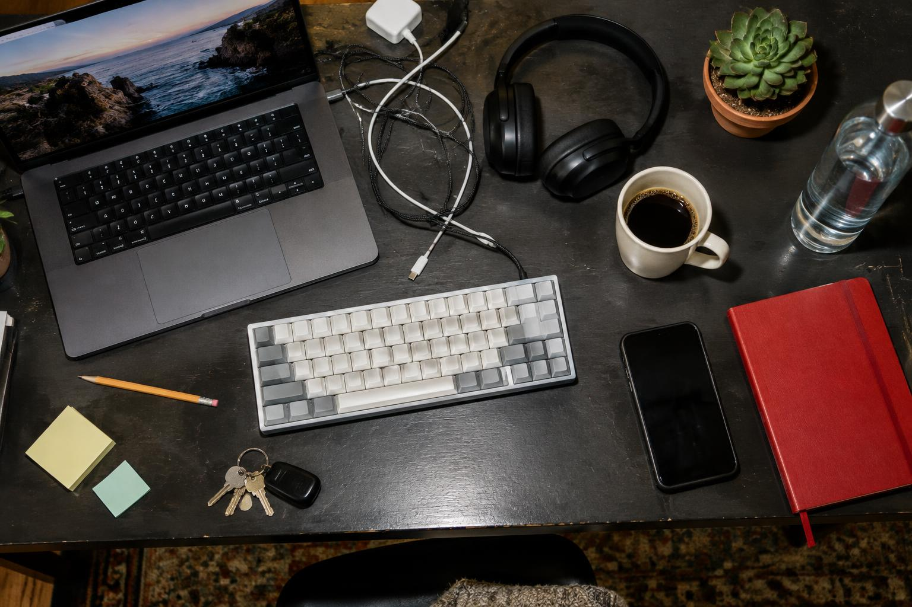

<div align="center">

# OBJECT CHAOS

**Your world. Your objects. Your chaos.**

A free browser party game that turns the mess on your desk into something worth laughing at.

[](#built-with)
[](#built-with)
[](#built-with)
[](#built-with)

</div>



## Ordinary objects. Extraordinary nonsense.

Your desk has a story. It is not a good story, but it is a story: the mug that has survived
three economic crises, the cable pile quietly forming a government, the plant that is the only
thing in the room with its life together.

OBJECT CHAOS takes a photo of all that and turns it into a game.

No account. No download. No setup. Just point it at your surroundings and start finding things.

## Three ways to make a mess

|                         |                                                                                                                                          |                        |
| ----------------------- | ---------------------------------------------------------------------------------------------------------------------------------------- | ---------------------- |
| 🔍 **Find the object**  | A challenge appears — something red, something you can drink from — and the clock is already running. Three rounds, sharp eyes required. | Score up to 300        |
| 🔥 **Object roast**     | Your surroundings get a personality, and the personality is unimpressed. The verdict arrives whether you asked for it or not.            | Chaos score out of 100 |
| 📋 **The chaos report** | Every round ends in an official, deeply unofficial report card. Share it, or download it and put it in the group chat.                   | Shareable card         |

## How it works

1. **Drop a photo** — your desk, your kitchen counter, that corner you keep meaning to deal with.
2. **Let the chaos scan** — objects get highlighted and turned into challenges.
3. **Play and share** — find things, get roasted, hand out the results.

## Honest by design

OBJECT CHAOS is a frontend demo. The detections are fixed demo data, not machine vision, and
your photo is never uploaded anywhere — it is read in your own browser and stays there.
Nothing is inferred, nothing is sent, and nothing is stored.

That also means it is fast, private, and works offline once the page has loaded.

## Built with

- [React 19](https://react.dev) + [TypeScript](https://www.typescriptlang.org)
- [TanStack Start](https://tanstack.com/start) and [TanStack Router](https://tanstack.com/router) for SSR and file-based routing
- [Vite](https://vite.dev) and [Nitro](https://nitro.build) for the build and server bundle
- [Tailwind CSS 4](https://tailwindcss.com) with a custom dark arcade design system
- [shadcn/ui](https://ui.shadcn.com) primitives, [lucide](https://lucide.dev) icons
- [Vitest](https://vitest.dev) for the game-logic tests

## Run it locally

```sh
bun install
bun run dev
```

Then open <http://localhost:3000>.

```sh
bun run build     # production build
bun run preview   # preview the build
bun run test      # game-logic and routing tests
```

---

A little mess. A lot of possibilities.
